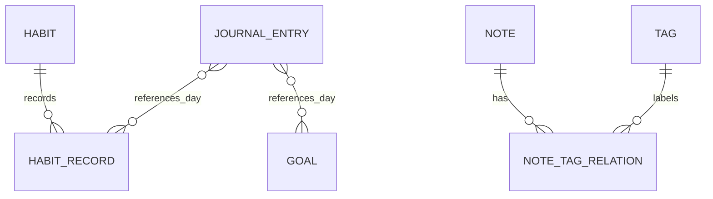

# LifeOS 阶段 0：调研与设计

更新时间：2026-10-14  
范围：仅完成开源项目调研、方案设计和实施计划，不修改业务代码。

## 0. 结论摘要

推荐采用 **从零构建 LifeOS，参考成熟开源项目的交互和边界设计**，而不是把某个现有应用直接改造成 LifeOS。

原因：

1. LifeOS 的核心组合是“每日操作台 + 目标 + 习惯 + 日记 + 笔记 + 可迁移数据”，调研项目都只覆盖其中一到两个重点。
2. 目标、习惯、日记和笔记的生命周期不同，直接套用单一项目的数据模型会带来迁移和删除策略问题。
3. 候选项目以 GPL、AGPL 或许可证字段不明确的项目为主。作为个人学习项目可以阅读和参考，但将代码混入独立产品前必须逐文件确认许可证和版权声明。
4. 当前工程只是 Android 应用空壳，直接建立清晰的 Kotlin、Compose、Room 和 Repository 边界，比先拆除一个不匹配的旧架构成本更低。

阶段 0 完成后的建议决策：

- 产品：本地优先、离线可用、用户掌控导入导出。
- UI：Jetpack Compose + Material 3，底部导航：首页、目标、笔记、习惯，日记和设置从更多入口进入。
- 架构：单 Activity、Navigation Compose、MVVM、Repository、Room、DataStore、Coroutines/Flow。
- 数据：稳定 UUID 作为跨设备和导入导出的主键；日期使用 ISO-8601 的本地日期，时间使用 UTC Instant。
- 备份：版本化 JSON；SAF 文件选择器；恢复前预览、确认，数据库事务内替换。
- 第一版不做：账号、云同步、支付、会员、复杂项目管理、自动加密备份。

## 1. GitHub 开源项目调研

### 1.1 调研方法和时间边界

数据来自 GitHub REST API 的公开仓库信息、仓库主页和 Release 页面，查询时间为 2026-10-14。`pushed_at`、Issue 数量和 Release 只用于判断维护活跃度，不代表代码质量或未来承诺。许可证以 GitHub API 的识别结果为准；显示 `NOASSERTION` 或 `Other` 的项目，在复用代码前必须打开仓库中的许可证文件再次确认。

### 1.2 候选项目

| 项目 | 主要能力 | 技术/平台 | API 许可证字段 | 最近活动（调研时） | 对 LifeOS 的价值 | 直接作为底座的风险 |
|---|---|---|---|---|---|---|
| [Markor](https://github.com/gsantner/markor) | Markdown、纯文本、todo.txt、文件编辑 | Android，Java | `NOASSERTION` | 推送 2026-10-10；Release `v2.16.1`（2026-03-19） | Markdown 编辑、文件导出、离线编辑交互 | 许可证需人工核验；文件型模型与 Room 业务实体不同 |
| [Tasks](https://github.com/tasks/tasks) | 待办、提醒、任务列表 | Android，Kotlin | GPL-3.0 | 推送 2026-10-13；Release `15.13`（2026-10-14） | 任务状态、优先级、截止日期、筛选 | GPL-3.0；任务模型偏提醒清单，没有笔记、日记和习惯域 |
| [Loop Habit Tracker](https://github.com/iSoron/uhabits) | 习惯、打卡、连续完成、统计 | Android，Kotlin | GPL-3.0 | 推送 2026-07-21；Release `v2.3.1`（2025-08-14） | 按日期保存记录、连续天数、统计和提醒边界 | GPL-3.0；习惯统计模型不能直接代表目标或日记 |
| [Fossify Notes](https://github.com/FossifyOrg/Notes) | 快速纯文本笔记 | Android，Kotlin | GPL-3.0 | 推送 2026-10-11；Release `1.7.0`（2026-01-30） | 快速记录、编辑、归档、简洁移动端操作 | GPL-3.0；功能和数据模型较轻，不覆盖标签关系与备份协议 |
| [Orgzly](https://github.com/orgzly/orgzly-android) | 大纲笔记、待办、纯文本同步 | Android，Kotlin | GPL-3.0 | 推送 2026-01-29；Release `v1.8.11`（2026-01-29） | 层级笔记、文本导入导出和离线使用 | GPL-3.0；Org-mode 数据模型与 LifeOS 的实体边界不同 |
| [Joplin](https://github.com/laurent22/joplin) | 笔记、Markdown、标签、同步、导入导出 | Android/桌面/移动，TypeScript | `NOASSERTION` | 推送 2026-10-13；Release `v3.7.21`（2026-09-25） | Markdown/JSON 迁移思路、冲突和资源处理 | 跨平台工程复杂；许可证字段需人工核验；同步服务超出第一版范围 |
| [Standard Notes](https://github.com/standardnotes/app) | 隐私笔记、加密、同步 | 跨平台，TypeScript | AGPL-3.0 | 推送 2026-10-14；Release `@standardnotes/desktop@3.202.7`（2026-09-17） | 数据隐私、版本化和加密功能的后续参考 | AGPL-3.0；服务端和加密体系对第一版过重 |

### 1.3 复用结论

- **可参考的设计**：Loop 的“定义与每日记录分离”；Tasks 的状态、优先级和截止时间；Markor/Joplin 的 Markdown 导出边界；Fossify Notes 的快速新增路径。
- **不直接拷贝的部分**：任何 GPL/AGPL 项目的业务代码、资源和未确认许可证的代码；Joplin 的同步服务、Standard Notes 的加密协议、Orgzly 的完整大纲语法。
- **推荐复用形式**：只吸收公开可见的交互思想和经过独立设计的数据协议；若未来需要引用代码，先建立 `THIRD_PARTY_NOTICES`，记录仓库、commit、文件范围、许可证和修改内容，并由用户确认发布方式。

## 2. 技术路线

### 2.1 方案比较

| 方案 | 维护成本 | 实现难度 | 适配程度 | 许可证风险 | 结论 |
|---|---:|---:|---:|---:|---|
| 基于成熟应用二次开发 | 中到高 | 初期低，后期高 | 中 | 中到高 | 不推荐作为第一版底座 |
| 从零构建，参考成熟交互 | 中 | 中 | 高 | 低 | 推荐 |
| 先做复杂跨平台/同步架构 | 高 | 高 | 低 | 低到中 | 不符合第一版范围 |

### 2.2 推荐技术栈

| 层 | 选择 | 目的 |
|---|---|---|
| 语言 | Kotlin | 空安全、协程、Android 官方支持 |
| UI | Jetpack Compose + Material 3 | 状态驱动 UI、主题和可访问性 |
| 导航 | Navigation Compose | 页面和深链参数集中管理 |
| 状态 | ViewModel + `StateFlow` | 生命周期感知、可测试、避免全局可变状态 |
| 结构化存储 | Room + SQLite | 关系、索引、事务、迁移和 Flow 查询 |
| 轻量配置 | Preferences DataStore | 主题、首次启动、导出偏好等非业务设置 |
| 异步 | Kotlin Coroutines/Flow | 所有数据库和文件 IO 脱离主线程 |
| 文件 | Storage Access Framework | 不申请不必要的存储权限，支持用户选择路径 |
| 测试 | JUnit、Room 测试、Compose UI Test | 覆盖数据边界、恢复事务和关键交互 |

当前工程的基线问题：`app/build.gradle.kts` 只有 AppCompat、Material View 和 Espresso 依赖，没有 Compose、Room、DataStore、Navigation 或 Kotlin Android 插件配置；`app/src/main` 没有业务 Kotlin 源码。阶段 1 再集中调整 Gradle 和包结构，阶段 0 不在此处改动。

## 3. PRD（第一版）

### 3.1 产品目标

让用户在离线环境中完成四件事：捕捉想法、整理目标和知识、执行当天行动、回顾并保管个人数据。

### 3.2 用户和使用场景

- 每天早上：打开 Daily Dashboard，查看当天必做事项和阶段重点。
- 产生想法时：从首页快速新增笔记，之后再分类或转为目标。
- 执行过程中：打卡习惯，更新目标下一步行动。
- 晚间复盘：写日记，查看当天完成的习惯和目标。
- 换机或归档时：导出 JSON/Markdown，或通过备份恢复。

### 3.3 功能范围

| 模块 | 第一版必须有 | 明确不纳入第一版 |
|---|---|---|
| 首页 | 日期、问候、今日习惯、必做事项、阶段重点、每日箴言、快速新增 | 复杂统计大屏、长期目标全量堆叠 |
| 目标 | CRUD、分类、优先级、状态、截止日期、下一步、搜索筛选、归档 | 甘特图、多人协作、复杂父子项目树 |
| 笔记 | 标题/正文、分类、标签、搜索、收藏、归档、删除确认、转目标 | 富文本编辑器、实时云同步 |
| 日记 | 按日期 CRUD、历史、搜索、四个可选引导问题、关联当天记录 | 情绪诊断、强制问卷 |
| 习惯 | 定义 CRUD、停用、按日期打卡、历史、连续完成和统计 | 社交排行、复杂周期规则 |
| 设置 | 主题、导入、导出、完整备份/恢复、清除数据、关于和版本 | 账号、加密同步、会员 |

### 3.4 核心验收口径

- 新增、编辑和删除笔记、目标、日记、习惯后，重启应用数据仍存在。
- 同一习惯在不同日期有独立 `HabitRecord`，更新今天不会覆盖昨天。
- 关键空状态、加载、保存中、成功和错误状态可见，且不会阻塞主线程。
- 导入先解析和预览，再由用户确认写入；无效文件不能清空原数据。
- 恢复使用单事务；失败时旧数据保持可用。
- 中文、换行、引号、反斜杠和常见特殊字符在导出再导入后保持一致。

## 4. 页面结构和交互流程

### 4.1 导航结构

```text
AppShell
├── Daily Dashboard
├── Goals
├── Notes
├── Habits
└── More
    ├── Journal
    └── Settings
        ├── Appearance
        ├── Import
        ├── Export
        ├── Backup & Restore
        ├── Data Management
        └── About
```

底部导航固定展示四个最高频入口；日记放入 More 是为了避免把首页和导航塞满，但首页和习惯完成后都能直达当天日记。

### 4.2 关键流程

**快速记录**：首页点击新增 → 选择笔记/目标/日记 → 编辑 → 显式保存或离开前自动保存草稿 → 返回来源页面并刷新。

**完成习惯**：首页或习惯页点击今天的记录 → 写入/更新 `(habitId, localDate)` 唯一记录 → 更新今日进度和连续天数 → 显示轻量反馈。

**笔记转目标**：笔记详情点击“转为目标” → 预填标题和正文摘要 → 用户补齐分类、优先级和下一步 → 创建目标并保留原笔记。

**导入**：SAF 选文件 → 限制大小并读取 → 判断 JSON/Markdown/ZIP → 校验格式和版本 → 展示实体数量、冲突和错误 → 用户选择合并或覆盖式恢复 → 确认 → 事务写入 → 展示结果。

**恢复**：选择备份 → 完整性检查 → 明确列出将被替换的实体范围 → 用户二次确认 → 事务内清空并重建 → 重新订阅 Flow → 显示完成或保留旧数据的失败结果。

## 5. 数据模型与数据库设计

### 5.1 实体职责

| 实体 | 职责 | 关键字段 |
|---|---|---|
| `Habit` | 可重复执行的习惯定义 | `id`, `title`, `targetValue`, `unit`, `isActive`, `createdAt`, `updatedAt` |
| `HabitRecord` | 某习惯某一天的实际记录 | `id`, `habitId`, `localDate`, `value`, `completedAt`, `note` |
| `Goal` | 阶段性结果和下一步行动 | `id`, `title`, `description`, `category`, `priority`, `status`, `nextAction`, `dueDate`, `completedAt` |
| `Note` | 可检索的知识和想法 | `id`, `title`, `body`, `category`, `isFavorite`, `isArchived`, `createdAt`, `updatedAt` |
| `Tag` | 可复用标签字典 | `id`, `name`, `createdAt` |
| `NoteTagRelation` | 笔记与标签的多对多关联 | `noteId`, `tagId` |
| `JournalEntry` | 一天一篇的反思记录 | `id`, `localDate`, `completedText`, `learnedText`, `reflectionText`, `tomorrowText`, `createdAt`, `updatedAt` |
| `AppPreference` | 只有轻量应用配置时使用 | `key`, `value`，或迁移到 DataStore |

### 5.2 关系和约束



- `HabitRecord` 对 `(habitId, localDate)` 建唯一索引，保证一天一条可更新记录。
- `JournalEntry` 对 `localDate` 建唯一索引，第一版默认一天一篇。
- `NoteTagRelation` 对 `(noteId, tagId)` 建联合主键，外键删除策略为级联关系清理。
- 业务实体使用字符串 UUID；导入时保留 ID，冲突策略由导入器处理，不依赖标题判断。
- `createdAt`/`updatedAt`/`completedAt` 使用 UTC `Instant` 序列化为 ISO-8601；`localDate` 使用 `YYYY-MM-DD`，不把时区偏移混进日期主键。
- 默认习惯使用普通种子数据，可被用户编辑、停用和删除；种子数据不在每次启动时重复插入。
- 删除笔记、目标或习惯前需确认；习惯删除默认保留历史记录的可解释性，产品实现时在 UI 明确选择“停用”或“连同记录删除”。

### 5.3 Room 版本和迁移

第一版数据库从 `version = 1` 开始；每次实体结构改变增加版本并提供显式 Migration。禁止用 `fallbackToDestructiveMigration` 处理正式用户数据。导入格式版本和 Room schema 版本分离：前者用于跨版本文件兼容，后者用于应用内部升级。

## 6. 导入、导出和恢复协议

### 6.1 完整 JSON

顶层结构建议如下：

```json
{
  "formatVersion": 1,
  "appName": "LifeOS",
  "exportedAt": "2026-10-14T12:00:00Z",
  "entities": {
    "habits": [],
    "habitRecords": [],
    "goals": [],
    "notes": [],
    "tags": [],
    "noteTagRelations": [],
    "journalEntries": []
  },
  "preferences": {}
}
```

字段和关联必须可校验；未知的未来字段允许忽略，未知的 `formatVersion` 必须明确拒绝。导出只写业务数据和必要配置，不写 SQLite 锁文件、临时缓存或日志。

### 6.2 Markdown 和 ZIP

- 单篇 Markdown：YAML front matter 保存 `id`、`title`、`category`、`tags`、`createdAt`、`updatedAt`，正文保存 `body`。
- 多篇导出：ZIP 内使用 `notes/<stable-id>.md`，文件名不直接使用未经清理的用户标题。
- 导入 ZIP：限制总大小、条目数量和单文件大小；拒绝绝对路径、`..` 路径和解压后越界路径，防范 Zip Slip。
- Markdown 导入无法确认稳定 ID 时，使用 front matter；缺失时只作为新笔记导入，不能因标题相同直接覆盖。

### 6.3 冲突策略

| 策略 | 行为 | 适用 |
|---|---|---|
| 合并导入 | 以稳定 ID 判断重复；新记录插入，重复记录按字段规则保留较新版本或跳过；关联先校验两端实体 | 日常迁移、追加外部数据 |
| 覆盖式恢复 | 明确显示会替换的实体范围；确认后在单事务内清理并重建 | 同一应用的完整备份恢复 |

任何解析、校验或事务异常都返回结构化错误摘要，不静默报告成功；事务失败时保留原数据。

## 7. 项目目录建议

```text
app/src/main/java/com/atlaes/lifeos/
├── LifeOsApplication.kt
├── MainActivity.kt
├── core/
│   ├── database/       # Room、Entity、Dao、Migration
│   ├── export/         # JSON、Markdown、ZIP、SAF
│   ├── import/         # 解析、校验、预览、冲突策略
│   ├── model/          # 跨层领域模型和枚举
│   ├── navigation/
│   └── ui/             # Theme、通用组件、状态
├── data/
│   ├── repository/
│   └── datastore/
└── feature/
    ├── dashboard/
    ├── goals/
    ├── notes/
    ├── journal/
    ├── habits/
    └── settings/
```

每个 feature 内部保持 `ui`、`ViewModel` 和用例调用边界；DAO 不直接暴露给 Composable。导入导出放在 core 是因为它横跨多个实体，但实际写库仍通过 Repository 和事务接口完成。

## 8. 分阶段计划与验收标准

### 阶段 0：调研与设计（当前）

- [x] GitHub 候选调研、维护状态和许可证风险记录
- [x] 方案比较和技术选型
- [x] PRD、页面流程、数据模型
- [x] 导入、导出、恢复协议和安全边界
- [x] 目录结构、实施计划和验收标准
- [ ] 用户确认方案后进入阶段 1

### 阶段 1：基础工程与静态 UI

交付：Compose 主题、导航壳、六个页面的静态状态、空状态和错误状态。  
验收：`assembleDebug` 通过；手机常见宽度无明显溢出；浅色/深色/跟随系统可切换；关键按钮有加载和点击反馈。

### 阶段 2：核心业务与本地存储

交付：Room schema、Repository、习惯/目标/笔记/日记 CRUD、默认习惯、核心 ViewModel。  
验收：单元测试覆盖 CRUD、日期隔离、重启持久化、中文和换行；数据库操作不在主线程。

### 阶段 3：整理功能与导出

交付：搜索、标签、收藏、归档、完整 JSON 导出、Markdown 导出、SAF 保存。  
验收：空数据库和特殊字符可导出；系统文件管理器可访问；写入失败显示明确原因。

### 阶段 4：导入与恢复

交付：JSON/Markdown/ZIP 解析、格式校验、预览、合并、覆盖式恢复、事务和错误摘要。  
验收：有效、无效、未知版本、重复记录、缺失字段、ZIP 路径穿越和事务失败均有测试；取消确认时原数据不变。

### 阶段 5：真机测试与发布

交付：真机验证、性能和可访问性检查、可安装 APK、构建和手动验证说明。  
验收：导航、主题、导入导出恢复和重启数据均在真实 Android 文件选择器上验证；报告已知限制，不以编译通过代替功能验证。

## 9. 阶段 1 开始前需要确认的边界

建议只确认以下三项，不阻塞阶段 0 交付：

1. 是否接受“从零构建，参考开源交互，不直接复制 GPL/AGPL 业务代码”。
2. 第一版是否采用底部四入口：首页、目标、笔记、习惯，并把日记、设置放在 More。
3. 是否接受普通 JSON 备份先于加密备份；加密备份作为后续版本，使用经过验证的标准方案。

